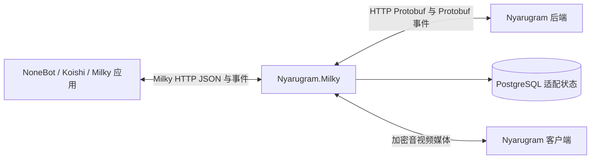

# Nyarugram.Milky

Nyarugram.Milky 是连接 Nyarugram 自部署服务与机器人应用的独立协议适配服务。机器人应用通过 Milky 调用消息能力，通过 Nyarugram 扩展接打电话，适配服务通过现有 Protobuf 接口操作登录账号。

当前仓库已推进到可构建、可运行、可独立发布的实现：登录、差分同步、事件推送、基础消息、呼叫控制面与真实 tgcalls 媒体引擎均已落地。真实双向语音已验证于两个独立适配实例之间；Android 真机音频、TURN 与正式部署仍需相应环境。功能完成情况以代码、测试与[交付报告](Docs/DELIVERY-REPORT.md)为准。

## 接入方式



Milky 对外通信采用标准要求的 JSON。连接 Nyarugram 后端时强制使用 Protobuf，适配服务的持久化状态使用 PostgreSQL。呼叫控制通过 Nyarugram 专用扩展提供，媒体由适配服务的通话模块处理。

## 首期可用范围

| 能力 | 实现目标 |
|---|---|
| 登录与账号 | 显式配置自部署服务器，以专用账号登录，支持密码及已开启的验证器验证、会话恢复、退出和失效处理 |
| 基础查询 | 当前账号、联系人、群、群成员及必要用户资料查询 |
| 收发消息 | 普通私聊和群聊的文字、原生可表达的提及与回复，消息查询、历史和已读 |
| 事件 | Milky 消息接收事件，断线重连、差分补偿、持久游标和可识别的重复投递 |
| 呼叫控制 | 一对一发起、来电通知、响铃确认、接听、拒接、挂断、忙线、超时和状态查询 |
| 真实双向语音 | 已实现：tgcalls 兼容引擎（Android `InstanceV2Impl` 13.0.0/12.0.0）；适配实例间双向 PCM 已验证，Android 真机与 TURN 未验证 |
| 应用接入 | NoneBot 2.5.0 + nonebot-adapter-milky 1.3.0 已完成消息、能力查询与呼叫编排验证 |

语音接通和双向传输是首期验收条件。视频作为单独能力声明，需要媒体输入输出和设备互通证据后才能标记可用。视频不可用时应在发起请求前明确拒绝视频参数。

现有后端已经提供消息、差分、认证和一对一通话 Protobuf 操作。适配服务需要实现机器人侧协议转换、账号状态及媒体处理。具体映射和通话要求见实现文档。

## Milky 兼容范围

- 以 Milky 1.3 的基础接口为初始设计基线。实现时锁定对应协议定义、版本及校验值，记录实际通过互操作的应用端版本。
- 首期实现基础子集及明确标识的 Nyarugram 扩展。每项接口、事件和消息段都维护支持矩阵。
- Milky 的 QQ 号字段通过 Nyarugram 稳定 TL 身份映射。Gram ID 作为展示及搜索身份处理。
- Milky 中 QQ 专属的客户端类型、等级等字段需要记录适配约定，并验证应用端的实际解析行为。资料未知时按照锁定 schema 的合法空值或明确的兼容配置处理。
- 呼叫扩展使用 `nyarugram_` API 前缀和独立事件名称。普通 Milky 消息插件可以使用标准接口，调用电话需要应用端显式支持扩展。

## 部署与凭据

部署者提供自己的 Nyarugram 后端、PostgreSQL 及通话所需 STUN/TURN。服务地址和协议身份域名必须显式填写。文档示例使用私网地址。

| 凭据 | 用途 |
|---|---|
| Nyarugram 登录凭据和会话令牌 | 适配服务作为账号访问自部署后端 |
| Milky access_token | 机器人应用访问适配服务 |
| 媒体访问令牌 | 应用连接特定通话的音频输入输出 |

分别生成、存储和撤销这些凭据。会话令牌等秘密加密存储，保护密钥放在数据库之外的受限配置或系统密钥设施中。PostgreSQL 数据和该保护密钥需要配套备份。

发布包提供 `init`、`login`、`serve`、`status`、`logout`、`version` 与 `/health` 就绪检查；安装、升级和部署见[运行手册](Docs/OPERATIONS.md)。

## 快速开始

```bash
nyarugram-milky init      # 生成 config/local.json（含随机令牌与保护密钥）
nyarugram-milky login     # 交互登录，密码与验证码隐藏输入
nyarugram-milky serve     # 启动 HTTP/事件服务，默认监听 127.0.0.1:8080
nyarugram-milky status    # 查看账号、会话代际、同步游标
```

配置项、端点与故障处理见[运行手册](Docs/OPERATIONS.md)。构建需要 .NET 8 SDK 与 PostgreSQL 16；数据库不存在时会自动创建。

```bash
dotnet build Nyarugram.Milky.sln
dotnet test tests/Nyarugram.Milky.Tests
```

集成测试需要可连的 PostgreSQL，可用 `NYARUGRAM_TEST_PG` 指定管理连接；不可达时测试会跳过而不是假通过。

## 已实现范围

| 能力 | 状态 |
|---|---|
| 登录与会话（密码 + 验证器、加密存储、代际隔离） | 已实现，有宿主测试 |
| 差分同步与游标、SSE/WebSocket 事件 | 已实现，有宿主测试 |
| 账号、好友、群、群成员查询 | 已实现（部分字段无后端来源） |
| 私聊/群聊文本、提及、回复、历史、已读 | 已实现，有宿主测试 |
| 呼叫控制（发起、接听、挂断、查询、扩展事件） | 已实现，有宿主测试 |
| 真实双向语音 | 已实现：tgcalls 兼容引擎，P2P 双向音频已验证（不同已知频率、排除串音/回环）；TURN 未配置，Android 真机未验证 |
| 媒体运行期故障 | 已实现：代理退出后通话失败并发出 `media_closed`，释放线路后可重拨 |
| 出站信令投递 | 已实现：有界保序、暂时失败重试、过期/溢出/耗尽失败路径；至少一次，不宣称恰好一次 |
| PostgreSQL 权威后端 | 已验证：隔离后端 `NewStoragePrimary` + `RelationalBackend`，`/health` 为 `storage=postgresql`；适配器状态库独立 |
| NoneBot 互操作 | 已实现：nonebot2 2.5.0 + nonebot-adapter-milky 1.3.0（消息、能力、呼叫发起/接听/挂断） |
| 图片、文件、语音消息、视频、群管理 | 未实现，返回明确错误 |

发送接口支持可选的 `nyarugram_idempotency_key`：同键同内容复用原结果，同键不同内容返回 `-409`，响应丢失后可用同键或后台对账恢复。事件消费可用 `nyarugram_consumer` 命名并在断线后按持久位点重放。

逐项字段差异与不支持项见[支持矩阵](Docs/SUPPORT-MATRIX.md)。

## 文档

- [开发与交付约束](AGENTS.md)
- [基础架构、接口映射与验收](Docs/IMPLEMENTATION.md)
- [呼叫扩展、媒体接口与通话验收](Docs/CALLS.md)
- [技术选型与实现结构](Docs/TECH-STACK.md)
- [支持矩阵](Docs/SUPPORT-MATRIX.md)
- [运行与配置](Docs/OPERATIONS.md)
- [媒体 WebSocket 契约](Docs/MEDIA-PROTOCOL.md)
- [原生媒体代理构建与运行](Docs/MEDIA-BUILD.md)
- [交付报告](Docs/DELIVERY-REPORT.md)

Milky 的接口、事件及字段以官方规范为依据。对 Nyarugram 的适配差异记录在本仓库的支持矩阵中。[Milky 官方文档](https://milky.ntqqrev.org/)
